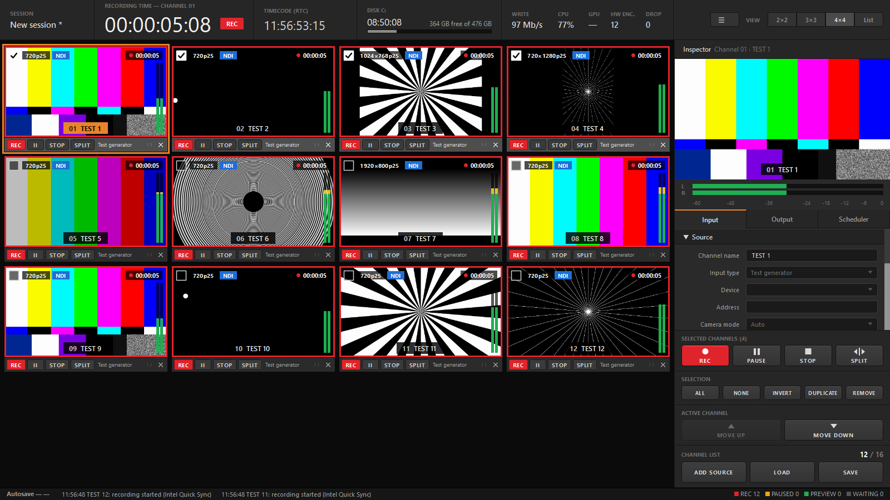

#  ISO Recorder

A Windows application that records 1 to 16 video channels with audio at the same time — each channel to its own file
("ISO recording"). It is meant for multi-camera production, conference and stream capture, and any job where the
material from every source must be kept in full for later editing.



## Features

**Sources**
- a whole screen or a single application window,
- a USB camera / capture card that shows up in Windows as a camera,
- HDMI / SDI through a Blackmagic DeckLink card (not yet tested on hardware),
- SRT and RTSP network streams,
- NDI sources found on the network (NDI|HX included),
- system sound, a microphone or a line input,
- a test generator (picture, clock and tone) for rehearsals,
- a channel can be switched off without removing it (input type "None"),
- channel frame rate 24 / 25 / 30 / 50 / 60 fps; camera modes are listed with their frame rate.

**Recording**
- H.264, H.265 (HEVC), AV1 or ProRes 422 with AAC sound, to MKV, MPEG‑TS, MP4 or MOV; the hardware encoder is picked
  automatically (NVIDIA NVENC, Intel Quick Sync, AMD AMF), with a software fallback for H.264, AV1 and ProRes,
- **stream copy** for SRT and RTSP: the stream is written exactly as it arrives, without re-encoding
  (H.264 or H.265, the sender's quality and bitrate),
- pause and resume within the same file, leaving no trace on the timeline,
- splitting into parts by hand or automatically (every N minutes / every N GB), also into a new folder,
- REC, PAUSE and STOP for a group of channels at the same instant — the files share a common zero point,
- a `.json` sidecar next to every recording (times, parts, pauses, signal losses) for syncing in the edit.

**Scheduler**
- recording rules per channel: weekly on chosen days or once on a chosen date, with an optional new file part every
  N minutes,
- recording starts exactly at the planned second; channels with the same start time begin together,
- a late start when the program was not running at the start time; the computer is kept awake while a recording is
  running or waiting.

**Live output**
- every channel can go out to NDI or SRT in parallel with its recording; this can be switched on and off while
  recording, or follow the recording schedule.

**Resilience**
- a lost network signal does not stop the recording; choose between keep recording, pause, or a new file part,
- a source that failed is restarted automatically and an interrupted recording resumes in a new file,
- a "Reconnect source" button for a camera or capture card that does not respond,
- free-space monitoring per disk and a write-speed test,
- channel list autosave and recovery after a crash,
- an event log written to a file.

**Interface**
- tile view (2×2, 3×3, 4×4) and list view with sorting by column, a large channel preview, audio meters,
- listening to a channel on a chosen sound card,
- channel lists saved to and loaded from files; default recording settings for new channels,
- languages: English, Polish, German, Spanish, Italian, French.

**Planned**
- several recording locations (a spare folder when the disk fills up, recording to two folders at once),
- WebRTC input (WHEP), an installer.

## Requirements

- Windows 10 (version 1903 or later) or Windows 11, 64-bit,
- a graphics card with an H.264 encoder (recommended); without one a slower software encoder is used,
- for NDI input and output: NDI Tools or the NDI Runtime installed.

Performance depends on the encoder. On the test machine (6 threads, Intel Quick Sync) 8 channels of 720p25 take about
2.3 CPU cores, and 16 channels is the limit.

## Installation

1. Download `IsoRecorder-<version>-win64.zip` from **Releases**.
2. Unpack it anywhere.
3. Run `IsoRecorder.exe`. Nothing needs to be installed — Qt and GStreamer are included.

If the program will not start with the last used channel list, hold **Shift** while launching it — it opens with an
empty list.

## Getting started

1. **ADD SOURCE** adds a channel. On the **Input** tab choose the source type and the device or address.
2. On the **Output** tab set the recording folder, container, encoder and bitrate; **Live output** is there too.
   The **Scheduler** tab holds the recording rules of the channel.
3. **REC** on a tile records one channel; select several channels and use the **Selected channels** panel to start
   them together.
4. **SAVE** stores the channel list in a file — the program opens it by itself next time.

Shortcuts: `R` record, `P` pause, `S` stop, `X` split, `Ctrl+A` select all, `Ctrl+S` save the list, arrow keys change
the active channel. Double-click a picture for the large preview.

## Building from source

You need: Visual Studio Build Tools (C++ and CMake), Qt 6 in `C:\Qt\<version>\msvc*_64`, and GStreamer 1.28 MSVC x64
(runtime and development packages).

```powershell
scripts\build.ps1      # builds into build\
scripts\run.ps1        # runs with the right paths
scripts\package.ps1    # assembles a standalone package in dist\IsoRecorder\
```

The tests (PowerShell, they need `ffprobe`) live in `tests\`; they are described in [AGENTS.md](AGENTS.md).

## Documentation

The project documents are written in Polish:

- [CHANGELOG.md](CHANGELOG.md) — version history,
- [instrukcja_koncowa.md](instrukcja_koncowa.md) — specification and how the mechanisms work,
- [AGENTS.md](AGENTS.md) — project state, working rules and the roadmap.

## Authors

Studio Krause + Claude Fable 5.2

The program uses the [Qt](https://www.qt.io/) and [GStreamer](https://gstreamer.freedesktop.org/) libraries (LGPL).
